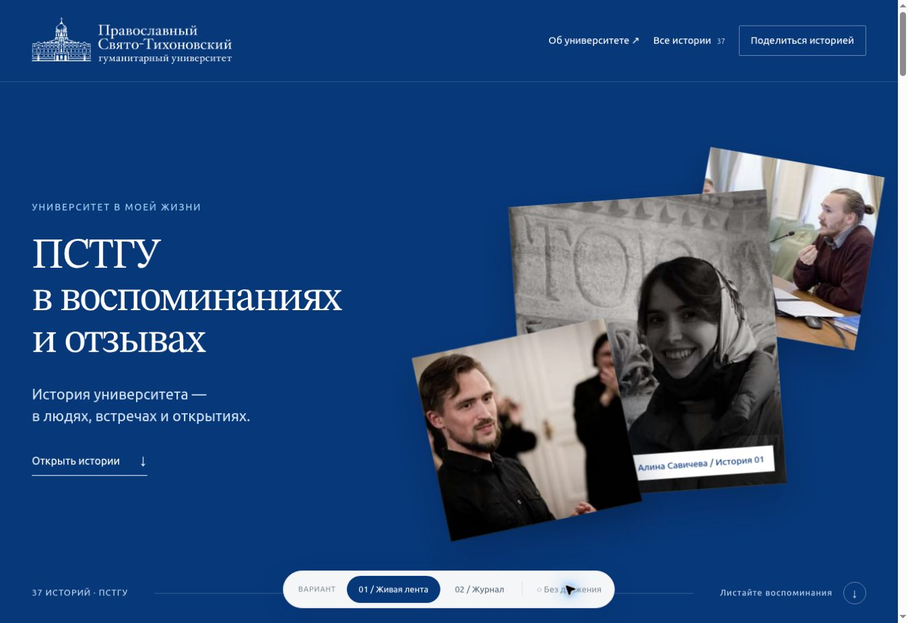

# ПСТГУ — страница отзывов

Два готовых десктопных варианта в одном прототипе:

1. **Живая лента** — коллаж портретов и объёмное появление фотографий при обычной прокрутке.
2. **Журнал воспоминаний** — крупные портреты, цитаты и нумерованный каталог.

Внизу страницы расположен переключатель вариантов и выключатель анимации. В обоих вариантах доступны все 37 отзывов: поиск по имени автора, раскрытие каталога и диалог с текстом истории.

## Запуск

Откройте `index.html` в браузере. Сборка, Node.js и установка пакетов не нужны.

Для локального сервера можно запустить `python -m http.server 8000` в папке проекта и открыть http://localhost:8000/.

Второй вариант открывается параметром `?concept=journal`, первый — `?concept=ribbon`.

## Файлы

- `index.html` — общий каркас, шапка, форма и футер.
- `style.css` — оформление обоих вариантов и анимация.
- `app.js` — переключение вариантов, анимация по скроллу, поиск и диалоги.
- `data.js` — все 37 имён и текстов.
- `assets/` — фотографии, логотип и локальные шрифты с лицензиями.

Анимация использует CSS transforms и requestAnimationFrame, без внешних библиотек и без перехвата прокрутки. Учтён prefers-reduced-motion.

## Макеты Figma

- [Живая лента](https://www.figma.com/design/yUAFW3qmkuFKkOpWpnaMSf?node-id=1660-5767)
- [Журнал воспоминаний](https://www.figma.com/design/yUAFW3qmkuFKkOpWpnaMSf?node-id=1661-5779)

Макеты 1920 px, контент 1280 px. В Figma сохранены исходные шапка, форма и футер. Новые блоки построены на автолэйаутах и компонентах.

## Перед передачей в разработку

- Это десктопный прототип; мобильная версия не разрабатывалась.
- Три фотографии повторяются по заданию и предполагают дальнейшую замену. Они не являются портретами всех указанных авторов.
- Форма демонстрационная: данные никуда не отправляются.
- Лицензии Ubuntu и STIX Two Text находятся в `assets/`. Права на фото и фирменные материалы принадлежат соответствующим правообладателям.
